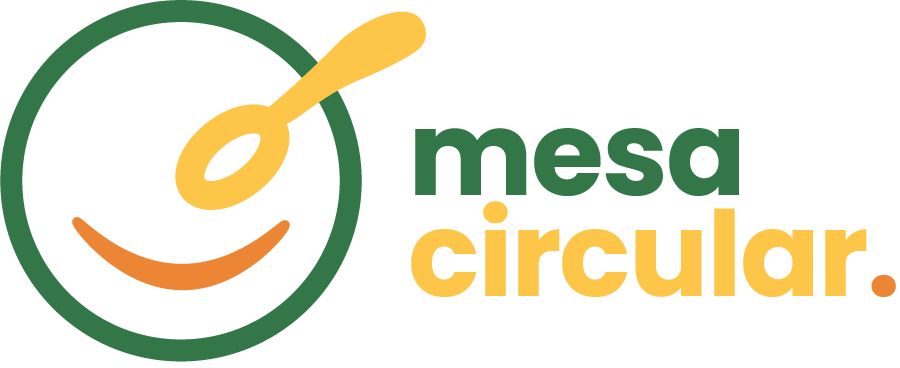
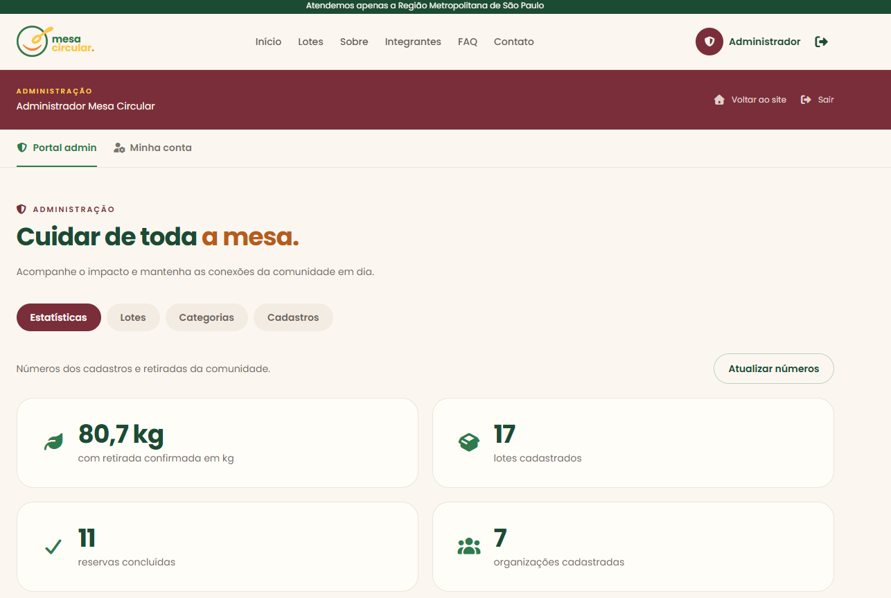

# Mesa Circular

<p align="center">
  
</p>

<p align="center">
  
</p>

<h3 align="center">
  Conectando quem tem excedente de alimentos com quem precisa deles.
</h3>

<p align="center">
  Projeto acadêmico desenvolvido para a <strong>Global Solution FIAP 2026 — CitizenTech</strong>.
</p>

<p align="center">
  
  
  
  
</p>

<p align="center">
  
  
  
</p>

---

## Sumário

- [Sobre o projeto](#sobre-o-projeto)
- [Problema identificado](#problema-identificado)
- [A solução](#a-solução)
- [Objetivos e ODS](#objetivos-e-ods)
- [Perfis de usuário](#perfis-de-usuário)
- [Tecnologias utilizadas](#tecnologias-utilizadas)
- [Principais dependências](#principais-dependências)
- [Arquitetura](#arquitetura)
- [Fluxo de inicialização](#fluxo-de-inicialização)
- [Estrutura de pastas](#estrutura-de-pastas)
- [Responsabilidade das pastas](#responsabilidade-das-pastas)
- [Sistema de rotas](#sistema-de-rotas)
- [Páginas da aplicação](#páginas-da-aplicação)
- [Componentes reutilizáveis](#componentes-reutilizáveis)
- [Integração com a API](#integração-com-a-api)
- [Gerenciamento de estado](#gerenciamento-de-estado)
- [Responsividade](#responsividade)
- [Acessibilidade](#acessibilidade)
- [Identidade visual](#identidade-visual)
- [Prints do projeto](#prints-do-projeto)
- [Qualidade e validações](#qualidade-e-validações)
- [Git Flow e versionamento](#git-flow-e-versionamento)
- [Como instalar](#como-instalar)
- [Como usar](#como-usar)
- [Scripts disponíveis](#scripts-disponíveis)
- [Deploy](#deploy)
- [Limitações atuais](#limitações-atuais)
- [Integrantes](#integrantes)
- [Links](#links)
- [Contato](#contato)
- [Conclusão](#conclusão)

---

## Sobre o projeto

O **Mesa Circular** é uma plataforma web que conecta quem tem **excedente de alimentos**
(feirantes, mercadinhos, produtores) com **organizações que precisam deles** (ONGs,
instituições sociais), para que comida boa não seja desperdiçada e chegue a quem mais
precisa.

A ideia central é simples e humana: *alimento que sobra de um lado, falta do outro — a
gente conecta os dois.* Uma pessoa publica um **lote** de alimentos (por exemplo, "12 kg
de legumes, retirar até as 17h"), uma organização **reserva** a quantidade de que precisa,
combina a retirada e o sistema acompanha tudo, mostrando o **impacto** gerado (quilos
aproveitados).

Este repositório contém o **front-end** da solução, desenvolvido em **React + Vite +
TypeScript**, no padrão SPA (Single Page Application), consumindo a **API REST em Java** do
grupo, publicada na nuvem.

---

## Problema identificado

O desperdício de alimentos é um problema sério e cotidiano. Muita comida boa é descartada
por feirantes, mercados e produtores no fim do expediente, enquanto organizações sociais
enfrentam dificuldade para conseguir alimentos. Faltam pontes simples, rápidas e locais
entre esses dois lados.

Além disso, quando existe alguma forma de doação, ela costuma ser informal e difícil de
acompanhar: não se sabe o que está disponível, quem reservou, nem se a retirada aconteceu.
Quanto mais burocracia e menos visibilidade, menos comida é aproveitada a tempo.

O Mesa Circular ataca exatamente esse ponto: reduzir o atrito entre quem tem o excedente e
quem precisa, com foco no aproveitamento rápido e no acompanhamento de todo o processo.

---

## A solução

A plataforma funciona em três passos simples:

1. **Publicar** — o ofertante cadastra um lote de alimentos (descrição, quantidade, prazo
   de retirada, bairro).
2. **Reservar** — a organização encontra o lote, filtra por bairro ou status e reserva a
   quantidade que precisa.
3. **Retirar** — combinam a retirada e confirmam; o sistema registra e contabiliza o
   impacto.

Tudo isso com um catálogo claro, filtros, um histórico para cada perfil acompanhar o que
publicou ou reservou, e um portal administrativo para moderar a plataforma.

---

## Objetivos e ODS

> **Objetivo principal:** reduzir o desperdício de alimentos conectando excedente e
> necessidade de forma simples, rápida e local.

Objetivos específicos:

- Diminuir o descarte de alimentos ainda próprios para consumo;
- Facilitar o acesso de organizações sociais a doações de alimentos;
- Tornar o processo transparente e acompanhável (o que há, quem reservou, o que foi retirado);
- Fortalecer redes locais de solidariedade;
- Oferecer uma experiência simples, acolhedora e acessível.

O projeto se conecta a dois Objetivos de Desenvolvimento Sustentável da ONU:

- **ODS 2 — Fome Zero e Agricultura Sustentável:** direciona alimentos que seriam
  descartados para quem precisa.
- **ODS 11 — Cidades e Comunidades Sustentáveis:** fortalece as comunidades locais e reduz
  resíduos nas cidades.

Alinhado ao tema da Global Solution: **CitizenTech — tecnologia com o cidadão no centro.**

---

## Perfis de usuário

A plataforma tem três perfis, cada um com login e sua própria área:

- **Ofertante** (feirante, mercado, produtor): publica lotes, acompanha os seus, vê quem
  reservou e confirma as retiradas.
- **Organização** (ONG, instituição): explora os lotes, reserva e acompanha o histórico das
  próprias reservas.
- **Administrador:** modera a plataforma — gerencia lotes, categorias e cadastros, e
  acompanha estatísticas gerais de impacto.

---

## Tecnologias utilizadas

### React
Responsável pela construção da interface por componentes (páginas, componentes
reutilizáveis, estados, formulários e navegação).

### TypeScript
Adiciona tipagem ao projeto. Os dados do domínio (Lote, Reserva, Ofertante, Organização,
Categoria) têm tipos definidos, o que reduz erros e deixa explícito o que cada parte espera.

### Vite
Ferramenta de desenvolvimento e build: inicia o servidor local, processa os módulos e gera
a versão final na pasta `dist`.

### Tailwind CSS
Responsável pela maior parte da estilização, com classes utilitárias e tokens de cor
próprios do projeto, garantindo consistência visual e responsividade.

### React Router DOM
Cuida da navegação da SPA: rotas estáticas, rota dinâmica (detalhe do lote), rotas
protegidas por perfil e página 404.

### Fetch API
Consumo da API REST em Java, sem bibliotecas externas de requisição (não utiliza Axios).

### Font Awesome e Google Fonts
Ícones da interface e a fonte **Poppins**, usada como tipografia principal.

---

## Principais dependências

```json
{
  "react": "^18.3.1",
  "react-dom": "^18.3.1",
  "react-router-dom": "^7.18.5"
}
```

Entre as dependências de desenvolvimento estão TypeScript, Vite, Tailwind CSS, PostCSS,
Autoprefixer e os tipos do React.

---

## Arquitetura

A aplicação é organizada por responsabilidade:

```text
index.html
  -> src/main.tsx
  -> SessaoProvider (contexto de sessão)
  -> RouterProvider (rotas)
  -> Layouts (MainLayout / AppLayout / AcessoLayout)
  -> Páginas
  -> Componentes + Serviços (API) + Tipos
```

- A camada de **serviços** (`src/services`) concentra todas as chamadas à API, os
  tratamentos de erro e as regras de domínio.
- Os **contextos** guardam a sessão em memória.
- Os **hooks** (`useConsulta`, `useAcao`, `useSessao`) padronizam os estados de
  carregando/erro/vazio e as ações de escrita, evitando repetição nas telas.

---

## Fluxo de inicialização

1. **`index.html`** — carrega a `div#root` e o script do Vite.
2. **`src/main.tsx`** — envolve a aplicação no `SessaoProvider` e no roteador, e importa o
   CSS global.
3. **Rotas** — o roteador decide qual página renderizar conforme a URL, usando os layouts
   compartilhados.
4. **Layouts** — `MainLayout` (site), `AcessoLayout` (login/cadastro) e `AppLayout` (área
   logada) organizam o que é comum a cada grupo de telas.

---

## Estrutura de pastas

```text
mesa-circular/
├── public/                 # logo, favicon e imagens estáticas
├── src/
│   ├── components/         # componentes reutilizáveis
│   ├── contexts/           # contexto de sessão
│   ├── data/               # dados de apoio (integrantes, imagens, contato)
│   ├── hooks/              # useConsulta, useAcao, useSessao
│   ├── layouts/            # MainLayout, AppLayout, AcessoLayout
│   ├── pages/              # páginas do site e da área logada
│   ├── routes/             # registro das rotas e rota protegida
│   ├── services/           # camada de API (fetch), erros e regras de domínio
│   ├── types/              # tipagens TypeScript
│   ├── main.tsx
│   └── index.css
├── index.html
├── vercel.json             # fallback de SPA para o deploy
├── vite.config.ts
├── tailwind.config.js
└── README.md
```

---

## Responsabilidade das pastas

- **public** — arquivos estáticos servidos direto (logo, favicon, imagens).
- **src/components** — blocos reutilizáveis usados em várias telas.
- **src/contexts** — o contexto de sessão (quem está logado e qual o perfil).
- **src/data** — conteúdos de apoio (integrantes, mapa de imagens, dados de contato).
- **src/hooks** — hooks próprios que padronizam consumo de API e sessão.
- **src/layouts** — estruturas compartilhadas entre grupos de páginas.
- **src/pages** — a implementação de cada tela.
- **src/routes** — a configuração das rotas e a proteção por perfil.
- **src/services** — a camada que conversa com a API e aplica as regras.
- **src/types** — os formatos esperados dos dados.

---

## Sistema de rotas

| Rota | Página | Observação |
|---|---|---|
| `/` | Home | Página inicial |
| `/sobre` | Sobre | Proposta, problema e ODS |
| `/integrantes` | Integrantes | Equipe (foto, RM, GitHub, LinkedIn) |
| `/faq` | FAQ | Perguntas frequentes |
| `/contato` | Contato | Formulário validado |
| `/lotes` | Lotes | Vitrine com filtros |
| `/lotes/:id` | Detalhe do Lote | **Rota dinâmica** (parâmetro na URL) |
| `/login` | Login | Acesso dos perfis |
| `/cadastro` | Cadastro | Ofertante ou organização |
| `/app` | Painel | Área logada (protegida) |
| `/app/conta` | Conta | Dados do perfil |
| `/app/publicar` | Publicar Lote | Ofertante |
| `/app/meus-lotes` | Meus Lotes | Ofertante |
| `/app/minhas-reservas` | Minhas Reservas | Organização (histórico) |
| `/admin` | Portal Admin | Gestão e estatísticas |
| `*` | NotFound | Rota inexistente |

A rota dinâmica `/lotes/:id` usa o parâmetro da URL para carregar o lote correspondente; se
o id não existir, a aplicação exibe uma mensagem e um caminho de volta para a lista.

---

## Páginas da aplicação

- **Home** — herói com a narrativa, faixa de impacto, "como funciona" em 3 passos, lotes em
  destaque (da API), seção de ODS e chamada para participar.
- **Sobre** — o problema do desperdício, a solução e os ODS 2 e 11.
- **Integrantes** — cards da equipe com foto, RM, turma, GitHub e LinkedIn.
- **FAQ** — perguntas frequentes em accordion.
- **Contato** — formulário com validação.
- **Lotes** — vitrine pública com filtro por bairro e status.
- **Detalhe do Lote** — todos os dados do lote e a reserva (rota dinâmica).
- **Login / Cadastro** — acesso e criação de conta dos perfis.
- **Painel** — resumo e atalhos conforme o perfil.
- **Publicar / Meus Lotes** — fluxo do ofertante.
- **Minhas Reservas** — histórico da organização.
- **Conta** — dados do usuário.
- **Portal Admin** — estatísticas, gestão de lotes, categorias e cadastros.

---

## Componentes reutilizáveis

- **CardLote** — card de um lote (imagem, descrição, quantidade, prazo, bairro e status).
- **TagStatus** — pílula colorida de status (disponível, reservado, retirado, vencido).
- **AvisoEstado** — estados de carregando, erro e vazio, usado em toda tela que chama a API.
- **CardImpacto** — número de impacto em destaque.
- **CampoFormulario** — input com label e mensagem de erro.
- **FormularioLote** — formulário de publicação/edição de lote.
- **ReservasLote** — lista de reservas de um lote (visão do ofertante).
- **Confirmacao** — diálogo de confirmação de ações importantes.
- **Feedback** — mensagens de erro e sucesso dos formulários.
- **Header, Footer, Logo, PageIntro, Icone, Imagem, ComoFunciona, SecaoODS, TeamCard** —
  base visual e institucional do site.

---

## Integração com a API

Todas as chamadas ficam centralizadas em **`src/services/api.ts`**, com a URL base numa
constante fácil de trocar:

```ts
export const API_BASE = "https://mesacircular-api.onrender.com";
```

A aplicação:

- **Lê dados (GET):** lotes, detalhe de lote, reservas, categorias e cadastros.
- **Grava dados (POST / PUT / DELETE):** cadastro, publicação de lote, reserva, confirmação
  de retirada, cancelamento, edição de perfil e o CRUD do admin.
- **Trata** carregando, erro e resposta vazia, com mensagens amigáveis e prevenção de envio
  duplicado.

As respostas são **tipadas em TypeScript** (interfaces em `src/types`). Como a API está
hospedada em um serviço gratuito, a primeira requisição após um período de inatividade pode
levar alguns segundos (cold start).

---

## Gerenciamento de estado

A sessão (quem está logado e qual o perfil) fica em um **Context** (em memória, sem
localStorage). Os hooks `useConsulta` e `useAcao` padronizam o consumo da API e os estados
de carregando/erro, enquanto os estados locais das telas usam os hooks do React
(`useState`, `useEffect`).

---

## Responsividade

Construído com **Tailwind CSS**, usando os breakpoints `sm:`, `md:`, `lg:` para adaptar
layout, grades e tipografia a **mobile (390px)**, **tablet (768px)** e **desktop (1440px)**,
sem rolagem horizontal e sem quebras de design.

---

## Acessibilidade

- `aria-label` em botões, links e listas;
- foco visível para navegação por teclado;
- `alt` nas imagens;
- `label` associado aos campos de formulário;
- mensagens de erro próximas aos campos;
- HTML semântico (header, main, section, footer, nav);
- bom contraste de cores.

---

## Identidade visual

Estilo moderno, colorido e acolhedor, com a fonte **Poppins**, cantos arredondados e fundo
creme (em vez de branco puro). Paleta:

| Token | Cor |
|---|---|
| Verde (principal) | `#2F7A4D` |
| Verde escuro | `#1C4B33` |
| Laranja | `#F28C38` |
| Amarelo | `#FFC94D` |
| Vinho | `#7A2E3A` |
| Rosa | `#F4A6B0` |
| Creme (fundo) | `#FBF7F0` |
| Tinta (texto) | `#241A17` |
| Linha (bordas) | `#ECE4D8` |

---

## Prints do projeto

> Coloque os prints na pasta `docs/prints/` com os nomes abaixo.

<p align="center">
  
</p>
<p align="center">
  
</p>
<p align="center">
  
</p>
<p align="center">
  
</p>
<p align="center">
  
</p>
<p align="center">
  
</p>

---

## Qualidade e validações

### Build
```bash
npm run build
```
Executa a verificação do TypeScript (`tsc -b`) e gera a versão de produção com o Vite.

### Preview
```bash
npm run preview
```
Visualiza localmente a versão gerada pelo build.

---

## Git Flow e versionamento

O projeto é versionado com **Git Flow**: cada funcionalidade em uma branch `feature/*`,
integrada em `develop` por Pull Request, e a `main` como versão estável. O histórico de
branches e PRs registra a evolução do projeto por etapas, com a participação de todas as
integrantes.

---

## Como instalar

Pré-requisitos: **Node.js**, **npm** e **Git**.

```bash
git clone URL_DO_REPOSITORIO
cd mesa-circular
npm install
```

---

## Como usar

### Links do projeto

| Recurso | Link |
|---------|------|
| Repositório (GitHub) | _preencher_ |
| Deploy (Vercel) | _preencher_ |
| API (Java) | https://mesacircular-api.onrender.com |
| Vídeo (YouTube) | _preencher_ |

A aplicação publicada na Vercel já consome remotamente a API em Java, permitindo os testes
online.

### Executar localmente

```bash
npm run dev
```

A aplicação abre em `http://127.0.0.1:5173`. A URL da API fica em `src/services/api.ts`.

---

## Scripts disponíveis

| Script | Comando | Descrição |
|---|---|---|
| `dev` | `npm run dev` | inicia o servidor de desenvolvimento |
| `build` | `npm run build` | verifica o TypeScript e gera a build de produção |
| `preview` | `npm run preview` | visualiza a build localmente |

---

## Deploy

A aplicação é publicada na **Vercel**. O arquivo `vercel.json` faz o *fallback* de SPA
(todas as rotas apontam para o `index.html`), garantindo que recarregar uma rota interna
como `/lotes/5` não retorne 404. O `base` do Vite está como `"/"` para os assets carregarem
corretamente em qualquer rota.

---

## Limitações atuais

- **Contatos fictícios:** os dados de contato (e-mail e redes sociais) são ilustrativos,
  usados apenas para fins acadêmicos.
- **Imagens por link:** a imagem de cada lote é informada por URL; quando ausente, o sistema
  usa uma imagem padrão por categoria.
- **Cold start da API:** por estar hospedada em um plano gratuito, a primeira requisição à
  API pode demorar alguns segundos.

---

## Integrantes

<table>
  <tr>
    <td align="center">
      <br/>
      <strong>Larissa Koprowski Ferreira</strong><br/>RM 572983 · 1TDSPF<br/>
      <a href="https://github.com/lkoprowskif">GitHub</a> ·
      <a href="https://www.linkedin.com/in/larissa-koprowski-111b3a357/">LinkedIn</a>
    </td>
    <td align="center">
      <br/>
      <strong>Lena Haidar Halawi</strong><br/>RM 572258 · 1TDSPF<br/>
      <a href="https://github.com/Lenahalawi07">GitHub</a> ·
      <a href="https://www.linkedin.com/in/lena-haidar-halawi-09134a3b8/">LinkedIn</a>
    </td>
    <td align="center">
      <br/>
      <strong>Lyvia Correa de Amorim</strong><br/>RM 589851 · 1TDSPF<br/>
      <a href="https://github.com/lyviaamorim">GitHub</a> ·
      <a href="https://www.linkedin.com/in/lyvia-correa-de-amorim-0203493b8/">LinkedIn</a>
    </td>
    <td align="center">
      <br/>
      <strong>Manuela de Lima Ramos</strong><br/>RM 572956 · 1TDSPF<br/>
      <a href="https://github.com/manuelalramos">GitHub</a> ·
      <a href="https://www.linkedin.com/in/manuelalramos/">LinkedIn</a>
    </td>
    <td align="center">
      <br/>
      <strong>Yasmin Souza Silva Martins</strong><br/>RM 572102 · 1TDSPF<br/>
      <a href="https://github.com/yasminmartins18">GitHub</a> ·
      <a href="https://www.linkedin.com/in/yasmin-souza-silva-martins-32085b376/">LinkedIn</a>
    </td>
  </tr>
</table>

---

## Links

```text
Repositório: https://github.com/manuelalramos/MesaCircular
Deploy (Vercel): preencher
API (Java): https://mesacircular-api.onrender.com
Vídeo (YouTube): preencher
```

---

## Contato

Dúvidas e sugestões podem ser enviadas pela página de **Contato** da aplicação ou pelos
perfis das integrantes na seção acima. Os canais exibidos na interface são fictícios e
servem apenas para demonstração deste projeto acadêmico.

---

## Conclusão

O **Mesa Circular** mostra como a tecnologia pode colocar o cidadão no centro: uma
plataforma simples que transforma o excedente de alimentos em solidariedade, reduzindo o
desperdício e fortalecendo a comunidade. O front-end foi construído com arquitetura
modular, integração real com a API em Java, três perfis de usuário, responsividade,
acessibilidade e deploy na nuvem — unindo propósito social e qualidade técnica.

---

<p align="center">
  <strong>Mesa Circular — alimento bom demais pra ir pro lixo.</strong>
</p>

<p align="center">
  Global Solution FIAP 2026 · CitizenTech
</p>

<p align="center">
  
</p>