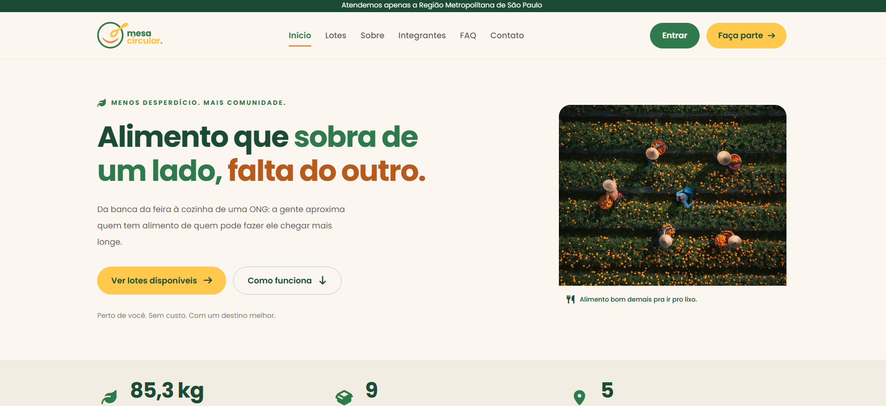
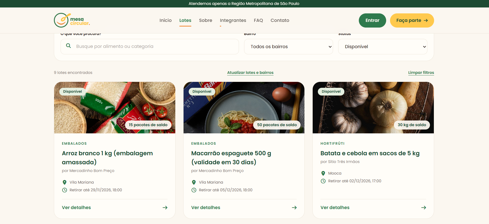
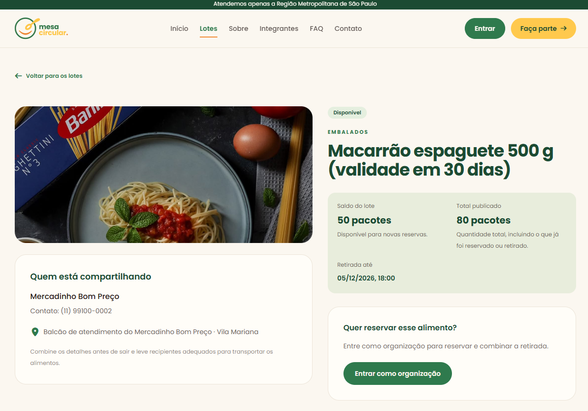
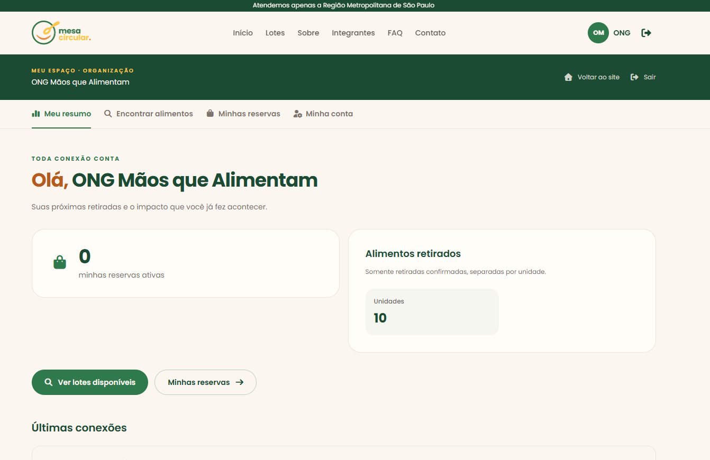
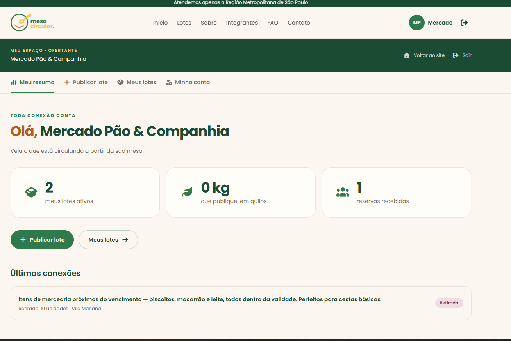
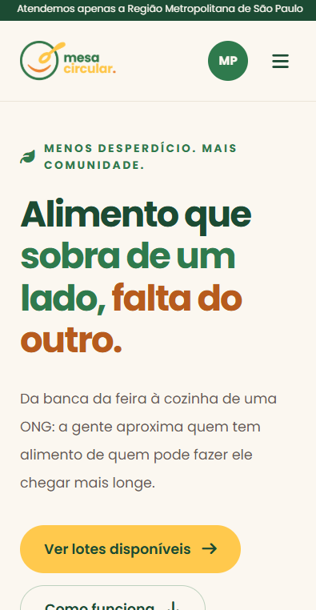

# Mesa Circular

<p align="center">
  
</p>

<p align="center">
  
</p>

<h3 align="center">
  Conectando quem tem excedente de alimentos com quem precisa deles.
</h3>

<p align="center">
  Projeto acadêmico desenvolvido para a <strong>Global Solution FIAP 2026 — CitizenTech</strong>.
</p>

<p align="center">
  
  
  
  
</p>

<p align="center">
  
  
  
</p>

---

## Sumário

- [Sobre o projeto](#sobre-o-projeto)
- [Problema identificado](#problema-identificado)
- [A solução](#a-solução)
- [Objetivos e ODS](#objetivos-e-ods)
- [Perfis de usuário](#perfis-de-usuário)
- [Tecnologias utilizadas](#tecnologias-utilizadas)
- [Principais dependências](#principais-dependências)
- [Arquitetura](#arquitetura)
- [Fluxo de inicialização](#fluxo-de-inicialização)
- [Estrutura de pastas](#estrutura-de-pastas)
- [Responsabilidade das pastas](#responsabilidade-das-pastas)
- [Sistema de rotas](#sistema-de-rotas)
- [Páginas da aplicação](#páginas-da-aplicação)
- [Componentes reutilizáveis](#componentes-reutilizáveis)
- [Integração com a API](#integração-com-a-api)
- [Gerenciamento de estado](#gerenciamento-de-estado)
- [Responsividade](#responsividade)
- [Acessibilidade](#acessibilidade)
- [Identidade visual](#identidade-visual)
- [Prints do projeto](#prints-do-projeto)
- [Qualidade e validações](#qualidade-e-validações)
- [Git Flow e versionamento](#git-flow-e-versionamento)
- [Como instalar](#como-instalar)
- [Como usar](#como-usar)
- [Scripts disponíveis](#scripts-disponíveis)
- [Deploy](#deploy)
- [Limitações atuais](#limitações-atuais)
- [Integrantes](#integrantes)
- [Links](#links)
- [Contato](#contato)
- [Conclusão](#conclusão)

---

## Sobre o projeto

O **Mesa Circular** é uma plataforma web que conecta quem tem **excedente de alimentos**
(feirantes, mercadinhos, produtores) com **organizações que precisam deles** (ONGs,
instituições sociais), para que comida boa não seja desperdiçada e chegue a quem mais
precisa.

A ideia central é simples e humana: *alimento que sobra de um lado, falta do outro — a
gente conecta os dois.* Uma pessoa publica um **lote** de alimentos (por exemplo, "12 kg
de legumes, retirar até as 17h"), uma organização **reserva** a quantidade de que precisa,
combina a retirada e o sistema acompanha tudo, mostrando as **quantidades efetivamente
retiradas**, separadas por unidade.

No momento, o Mesa Circular atende apenas a **Região Metropolitana de São Paulo**. As
reservas são destinadas a organizações cadastradas, como ONGs e instituições sociais,
para atender uma comunidade. A plataforma não oferece reservas para consumo individual
de pessoas físicas nem realiza entregas.

Este repositório contém o **front-end** da solução, desenvolvido em **React + Vite +
TypeScript**, no padrão SPA (Single Page Application), consumindo a **API REST em Java** do
grupo, publicada na nuvem.

---

## Problema identificado

O desperdício de alimentos é um problema sério e cotidiano. Muita comida boa é descartada
por feirantes, mercados e produtores no fim do expediente, enquanto organizações sociais
enfrentam dificuldade para conseguir alimentos. Faltam pontes simples, rápidas e locais
entre esses dois lados.

Além disso, quando existe alguma forma de doação, ela costuma ser informal e difícil de
acompanhar: não se sabe o que está disponível, quem reservou, nem se a retirada aconteceu.
Quanto mais burocracia e menos visibilidade, menos comida é aproveitada a tempo.

O Mesa Circular ataca exatamente esse ponto: reduzir o atrito entre quem tem o excedente e
quem precisa, com foco no aproveitamento rápido e no acompanhamento de todo o processo.

---

## A solução

A plataforma funciona em três passos simples:

1. **Publicar** — o ofertante informa descrição, quantidade total, unidade, categoria,
   bairro, local e prazo de retirada. Também pode adicionar um link público para a foto.
2. **Reservar** — a organização busca por alimento ou categoria, filtra por bairro e
   status e reserva uma quantidade dentro do saldo disponível. A reserva já fica ativa.
3. **Retirar** — organização e ofertante combinam os detalhes pelo contato informado.
   Depois da entrega, o ofertante confirma a quantidade realmente retirada em **Meus
   lotes**. Esse valor entra no resumo da organização.

Tudo isso com um catálogo claro, filtros, um histórico para cada perfil acompanhar o que
publicou ou reservou, e um portal administrativo para moderar a plataforma.

---

## Objetivos e ODS

> **Objetivo principal:** reduzir o desperdício de alimentos conectando excedente e
> necessidade de forma simples, rápida e local.

Objetivos específicos:

- Diminuir o descarte de alimentos ainda próprios para consumo;
- Facilitar o acesso de organizações sociais a doações de alimentos;
- Tornar o processo transparente e acompanhável (o que há, quem reservou, o que foi retirado);
- Fortalecer redes locais de solidariedade;
- Oferecer uma experiência simples, acolhedora e acessível.

O projeto se conecta a dois Objetivos de Desenvolvimento Sustentável da ONU:

- **ODS 2 — Fome Zero e Agricultura Sustentável:** direciona alimentos que seriam
  descartados para quem precisa.
- **ODS 11 — Cidades e Comunidades Sustentáveis:** fortalece as comunidades locais e reduz
  resíduos nas cidades.

Alinhado ao tema da Global Solution: **CitizenTech — tecnologia com o cidadão no centro.**

---

## Perfis de usuário

A plataforma tem três perfis, cada um com login e sua própria área:

- **Ofertante** (feirante, mercado, produtor): publica e edita seus lotes, informa a foto
  por link, acompanha quem reservou e confirma as retiradas. O painel mostra os totais
  publicados por unidade e atividades recentes com acesso direto às reservas do lote.
- **Organização** (ONG, instituição): explora os lotes, reserva, cancela reservas ativas e
  acompanha o histórico. O painel mostra reservas ativas e alimentos efetivamente
  retirados por unidade, com atalhos para cada reserva.
- **Administrador:** modera a plataforma — gerencia lotes, categorias e cadastros, e
  acompanha estatísticas gerais de impacto. Pode pesquisar e filtrar lotes por status,
  editar o link da imagem e ativar ou inativar um lote.

Os perfis são escolhidos na tela de login; o administrador usa **Acesso do administrador**.
O cadastro público está disponível para ofertantes e organizações. Após entrar, o nome
ou ícone de perfil no cabeçalho leva ao painel correspondente.

---

## Tecnologias utilizadas

### React
Responsável pela construção da interface por componentes (páginas, componentes
reutilizáveis, estados, formulários e navegação).

### TypeScript
Adiciona tipagem ao projeto. Os dados do domínio (Lote, Reserva, Ofertante, Organização,
Categoria) têm tipos definidos, o que reduz erros e deixa explícito o que cada parte espera.

### Vite
Ferramenta de desenvolvimento e build: inicia o servidor local, processa os módulos e gera
a versão final na pasta `dist`.

### Tailwind CSS
Responsável pela maior parte da estilização, com classes utilitárias e tokens de cor
próprios do projeto, garantindo consistência visual e responsividade.

### React Router DOM
Cuida da navegação da SPA: rotas estáticas, rota dinâmica (detalhe do lote), rotas
protegidas por perfil e página 404.

### Fetch API
Consumo da API REST em Java, sem bibliotecas externas de requisição (não utiliza Axios).

### Font Awesome e Google Fonts
Ícones da interface e a fonte **Poppins**, usada como tipografia principal.

---

## Principais dependências

```json
{
  "@fortawesome/fontawesome-free": "^7.3.1",
  "react": "^19.3.1",
  "react-dom": "^19.3.1",
  "react-router-dom": "^7.18.5"
}
```

As faixas de versão declaradas em `package.json` incluem **TypeScript `~7.0.2`**, **Vite
`^8.3.6`** e **Tailwind CSS `^3.4.17`**. O projeto também usa o plugin React do Vite,
PostCSS, Autoprefixer, os tipos do React e do Node e **Oxlint** para análise estática.
O `package-lock.json` registra as versões resolvidas das dependências.

---

## Arquitetura

A aplicação é organizada por responsabilidade:

```text
index.html
  -> src/main.tsx
  -> BrowserRouter (navegação)
  -> SessaoProvider (contexto de sessão)
  -> App -> Rotas (Routes / Route)
  -> MainLayout (site) -> AppLayout (área logada)
  -> Páginas
  -> AcessoLayout (composição das telas de login e cadastro)
  -> Componentes + Serviços (API) + Tipos
```

- A camada de **serviços** (`src/services`) concentra todas as chamadas à API, os
  tratamentos de erro e as regras de domínio.
- O **contexto de sessão** mantém o perfil em memória e restaura os dados salvos no
  `localStorage`, preservando o acesso ao recarregar a página.
- Os **hooks** (`useConsulta`, `useAcao`, `useSessao`) padronizam as consultas, ações de
  escrita e acesso à sessão. O `useAgora` atualiza o horário usado na situação dos lotes.
- `contrato.ts` converte os campos da API Java para os tipos usados pela interface;
  `regras.ts` concentra validações, datas e resumos de quantidades.

---

## Fluxo de inicialização

1. **`index.html`** — carrega a `div#root` e o script do Vite.
2. **`src/main.tsx`** — importa os estilos globais e do Font Awesome e renderiza
   `StrictMode > BrowserRouter > SessaoProvider > App`.
3. **`App` e `Rotas`** — definem a página correspondente à URL. `RotaProtegida` verifica
   se há sessão e se o perfil pode acessar aquela área.
4. **Layouts** — `MainLayout` compartilha cabeçalho e rodapé; `AppLayout` organiza o
   painel e sua navegação. Login e cadastro usam `AcessoLayout` dentro de suas páginas.

---

## Estrutura de pastas

```text
mesa-circular/
├── docs/prints/            # capturas de tela usadas no README
├── public/                 # logos e favicon
├── src/
│   ├── assets/integrantes/ # fotos da equipe
│   ├── components/         # componentes reutilizáveis
│   ├── contexts/           # contexto de sessão
│   ├── data/               # dados de apoio (integrantes, imagens, contato)
│   ├── hooks/              # useConsulta, useAcao, useSessao e useAgora
│   ├── layouts/            # MainLayout, AppLayout, AcessoLayout
│   ├── pages/              # páginas do site e da área logada
│   ├── routes/             # registro das rotas e rota protegida
│   ├── services/           # camada de API (fetch), erros e regras de domínio
│   ├── types/              # tipagens TypeScript
│   ├── App.tsx
│   ├── main.tsx
│   └── index.css
├── index.html
├── package.json
├── package-lock.json
├── vercel.json             # fallback de SPA para o deploy
├── vite.config.ts
├── tailwind.config.js
└── README.md
```

---

## Responsabilidade das pastas

- **public** — arquivos estáticos servidos direto (logo, favicon, imagens).
- **docs/prints** — imagens de demonstração da interface incluídas nesta documentação.
- **src/assets/integrantes** — fotos locais importadas pelos cards da equipe.
- **src/components** — blocos reutilizáveis usados em várias telas.
- **src/contexts** — o contexto de sessão (quem está logado e qual o perfil).
- **src/data** — conteúdos de apoio (integrantes, mapa de imagens, dados de contato).
- **src/hooks** — hooks próprios que padronizam consumo de API e sessão.
- **src/layouts** — estruturas compartilhadas entre grupos de páginas.
- **src/pages** — a implementação de cada tela.
- **src/routes** — a configuração das rotas e a proteção por perfil.
- **src/services** — a camada que conversa com a API e aplica as regras.
- **src/types** — os formatos esperados dos dados.

---

## Sistema de rotas

| Rota | Página | Observação |
|---|---|---|
| `/` | Home | Página inicial |
| `/sobre` | Sobre | Proposta, problema e ODS |
| `/integrantes` | Integrantes | Equipe (foto, RM, GitHub, LinkedIn) |
| `/faq` | FAQ | Perguntas frequentes |
| `/contato` | Contato | Formulário validado |
| `/lotes` | Lotes | Vitrine com filtros |
| `/lotes/:id` | Detalhe do Lote | **Rota dinâmica** (parâmetro na URL) |
| `/login` | Login | Acesso dos perfis |
| `/cadastro` | Cadastro | Ofertante ou organização |
| `/app` | Painel | Resumo de ofertante ou organização; administrador vai para `/admin` |
| `/app/conta` | Conta | Dados do perfil |
| `/app/publicar` | Publicar Lote | Ofertante |
| `/app/meus-lotes` | Meus Lotes | Ofertante |
| `/app/minhas-reservas` | Minhas Reservas | Organização (histórico) |
| `/admin` | Portal Admin | Gestão e estatísticas; exclusivo do administrador |
| `*` | NotFound | Rota inexistente |

A rota dinâmica `/lotes/:id` usa o parâmetro da URL para carregar o lote correspondente; se
o id não existir, a aplicação exibe uma mensagem e um caminho de volta para a lista.

As atividades recentes também usam atalhos dentro das rotas existentes:

- `/app/meus-lotes?lote=ID` abre as reservas de um lote do ofertante e mantém a seleção
  ao recarregar a página.
- `/app/minhas-reservas#reserva-ID` leva à reserva da organização, com destaque visual
  e foco no card.
- No detalhe de um lote, a organização encontra **Minhas reservas**. O ofertante vê
  **Ver reservas do lote** quando o lote pertence a ele.

---

## Páginas da aplicação

- **Home** — herói com a narrativa, faixa de impacto, "como funciona" em 3 passos, lotes em
  destaque (da API), seção de ODS e chamada para participar.
- **Sobre** — o problema do desperdício, a solução e os ODS 2 e 11.
- **Integrantes** — cards da equipe com foto, RM, turma, GitHub e LinkedIn.
- **FAQ** — perguntas frequentes em accordion, incluindo a diferença entre ofertante e
  organização e quem pode reservar.
- **Contato** — formulário com validação.
- **Lotes** — vitrine pública com busca por alimento ou categoria, filtros por bairro e
  status e atualização dos dados. Os bairros vêm da API, com cidade e UF.
- **Detalhe do Lote** — imagem, saldo disponível, total publicado, prazo e dados para
  combinar a retirada, além do formulário de reserva e dos atalhos para o painel.
- **Login / Cadastro** — acesso e criação de conta dos perfis.
- **Painel** — totais por unidade e atividades recentes, com atalhos conforme o perfil.
- **Publicar / Meus Lotes** — publicação, edição, foto por link e acompanhamento de
  reservas, com confirmação da quantidade entregue pelo ofertante.
- **Minhas Reservas** — histórico da organização, com filtros por situação e cancelamento
  de reservas ativas.
- **Conta** — dados do usuário e alteração de e-mail ou senha mediante a senha atual.
- **Portal Admin** — estatísticas da API, quantidades reservadas e retiradas por unidade,
  busca e filtro de lotes, edição, ativação/inativação, categorias e cadastros.

---

## Componentes reutilizáveis

- **CardLote** — card de um lote (imagem, descrição, quantidade, prazo, bairro e status).
- **TagStatus** — pílula colorida de status (disponível, reservado, retirado, vencido e inativo).
- **AvisoEstado** — estados de carregando, erro e vazio, usado em toda tela que chama a API.
- **CardImpacto** — número de impacto em destaque.
- **ResumoQuantidades** — totais separados em kg, litros, unidades, caixas e pacotes;
  compartilhado pelos painéis de ofertante e organização.
- **CampoFormulario** — input com label e mensagem de erro.
- **FormularioLote** — formulário de publicação/edição de lote.
- **ReservasLote** — lista de reservas de um lote (visão do ofertante).
- **Confirmacao** — diálogo de confirmação de ações importantes.
- **Feedback** — mensagens de erro e sucesso dos formulários.
- **LimiteErro** — apresenta uma alternativa de recuperação quando uma tela falha ao renderizar.
- **Header, Footer, Logo, PageIntro, Icone, Imagem, ComoFunciona, SecaoODS, TeamCard** —
  base visual e institucional do site.

---

## Integração com a API

Todas as chamadas usam **Fetch API** e ficam centralizadas em **`src/services/api.ts`**.
A URL base aceita configuração por variável de ambiente, com a API do Render como padrão:

```ts
export const API_BASE = import.meta.env?.VITE_API_BASE || 'https://mesacircular-api.onrender.com';
```

A aplicação:

- **Lê dados (GET):** lotes, detalhe de lote, reservas, bairros, categorias, cadastros e
  estatísticas.
- **Grava dados (POST / PUT / DELETE):** cadastro, publicação de lote, reserva, confirmação
  de retirada, cancelamento, edição de perfil e o CRUD do admin.
- **Trata** carregando, erro e resposta vazia, com mensagens amigáveis e prevenção de envio
  duplicado.

As respostas são **tipadas em TypeScript** (interfaces em `src/types`). O arquivo
`src/services/contrato.ts` adapta os campos da API, como `descricaoLote`, `imagemUrl`,
`nomeOfertante` e `nomeOrganizacao`, para os nomes utilizados nas páginas.

Alguns endpoints consumidos:

| Recurso | Operações usadas |
|---|---|
| `/ofertantes/login`, `/organizacoes/login`, `/administradores/login` | `POST` para entrar com o perfil escolhido |
| `/lotes` e `/lotes/:id` | `GET`, `POST`, `PUT` e `DELETE` para consulta e gestão de lotes |
| `/ofertantes/:id/lotes` | `GET` dos lotes de um ofertante |
| `/lotes/:id/reservas` e `/organizacoes/:id/reservas` | `GET` das reservas por lote ou organização |
| `/reservas` e `/reservas/:id` | `GET`, `POST`, `PUT` e `DELETE` para consulta, reserva, retirada e cancelamento |
| `/bairros` | `GET` dos bairros cadastrados |
| `/categorias`, `/ofertantes` e `/organizacoes` | Consulta e cadastro; edição de categorias e exclusão de registros conforme o recurso |
| `/estatisticas` | `GET` dos indicadores gerais |
| `/contatos` | `POST` do formulário de contato |

Como o serviço no Render pode precisar iniciar após um período de inatividade, a primeira
conexão pode demorar. `AvisoEstado` orienta a pessoa a aguardar e oferece nova tentativa
quando uma consulta falha. Cada requisição tem limite de **75 segundos**; gravações não
são repetidas automaticamente.

### Quantidades, saldo e datas

- As unidades disponíveis são **kg**, **litros (`l`)**, **unidades (`un`)**, **caixas
  (`cx`)** e **pacotes (`pct`)**. Kg e litros aceitam frações; as demais usam inteiros.
- **Total publicado** é a quantidade original do lote; **saldo** é o que ainda está
  disponível para novas reservas. Por exemplo, publicar 40 pacotes não equivale a 40 kg.
- O painel do ofertante soma as quantidades publicadas por unidade, incluindo lotes
  encerrados. O painel da organização soma somente a **quantidade realmente retirada**
  em entregas confirmadas. Reservas canceladas não entram nesse total.
- Não há conversão automática de litros, caixas, pacotes ou unidades para quilos. O
  indicador geral em kg usa a unidade kg; os demais totais permanecem separados.
- As datas são exibidas no fuso **America/Sao_Paulo**. Datas do Java sem indicação de
  fuso são interpretadas como horário de São Paulo.
- `useAgora` atualiza o horário a cada 30 segundos e ao retornar à página. Lotes ativos
  que ainda não foram retirados são exibidos como vencidos quando o prazo termina.
  Reabrir um lote que a API já retorna como vencido depende da regra do backend.

---

## Gerenciamento de estado

A sessão fica no **`SessaoContext`**, mantido por `SessaoProvider`. Os dados de perfil
usados pela interface são salvos no **`localStorage`**, na chave `mesa-circular:sessao`,
para restaurar o acesso após recarregar a página. **Senhas não são armazenadas**. Ao sair,
a sessão é removida e a navegação volta à Home; alterações no armazenamento são
sincronizadas entre abas.

Os hooks `useConsulta` e `useAcao` padronizam consultas, ações e feedback. As telas usam
estado local para formulários e filtros; a seleção de reservas de um lote fica na query
string, e o atalho para uma reserva usa o fragmento da URL. A proteção das rotas por
perfil é feita por `RotaProtegida`; a validação das operações remotas cabe à API Java.

---

## Responsividade

Construído com **Tailwind CSS**, usando os breakpoints `sm:`, `md:`, `lg:` para adaptar
layout, grades e tipografia. As resoluções de referência da entrega são **mobile
(390 × 844 px)**, **tablet (768 × 1024 px)** e **desktop (1440 × 900 px)**.

No celular, o acesso ao painel no cabeçalho usa o ícone do perfil, com nome acessível
para leitores de tela. A navegação principal usa um menu recolhível.

---

## Acessibilidade

- `aria-label` em botões, links e listas;
- foco visível para navegação por teclado;
- `alt` nas imagens;
- `label` associado aos campos de formulário;
- mensagens de erro próximas aos campos;
- HTML semântico (header, main, section, footer, nav);
- link para pular diretamente ao conteúdo;
- avisos de carregamento, erro e sucesso com `role` e `aria-live`;
- foco e destaque no card ao abrir uma reserva pelo atalho do painel.

---

## Identidade visual

Estilo moderno, colorido e acolhedor, com a fonte **Poppins**, cantos arredondados e fundo
creme (em vez de branco puro). Paleta:

| Token | Cor |
|---|---|
| Verde (principal) | `#2F7A4D` |
| Verde escuro | `#1C4B33` |
| Laranja | `#F28C38` |
| Amarelo | `#FFC94D` |
| Vinho | `#7A2E3A` |
| Rosa | `#F4A6B0` |
| Creme (fundo) | `#FBF7F0` |
| Tinta (texto) | `#241A17` |
| Linha (bordas) | `#ECE4D8` |

---

## Prints do projeto

<p align="center">
  
</p>
<p align="center">
  
</p>
<p align="center">
  
</p>
<p align="center">
  
</p>
<p align="center">
  
</p>
<p align="center">
  
</p>
<p align="center">
  
</p>

---

## Qualidade e validações

### Análise estática

```bash
npm run lint
```

Executa o Oxlint para identificar problemas no código.

### Build

```bash
npm run build
```

Executa a verificação do TypeScript (`tsc -b`) e gera a versão de produção com o Vite.

### Preview

```bash
npm run preview
```

Visualiza localmente a versão gerada pelo build.

### Script de testes

```bash
npm test
```

O script está configurado para executar `tests/*.test.ts` com o runner nativo do Node.
**A pasta `tests/` não está presente nesta versão do repositório**: a execução local
com Node 24.16.0 encontra zero testes. Portanto, esse comando ainda não representa
cobertura de testes automatizados.

### Conferência manual

Para validar o fluxo integrado, use contas de teste da API e confira:

1. Navegação pública, busca e filtros de lotes, detalhe e página não encontrada.
2. Login com cada perfil, permanência da sessão ao recarregar e saída da conta.
3. Publicação e edição de um lote pelo ofertante, incluindo foto por link.
4. Reserva pela organização e confirmação da quantidade entregue pelo ofertante.
5. Totais separados por unidade e atalhos em **Atividades recentes**.
6. Busca, filtros e edição de lotes no portal administrativo.
7. Formulários, mensagens de erro e carregamento e navegação por teclado nas três
   resoluções de referência.

---

## Git Flow e versionamento

O fluxo da equipe usa branches `feature/*` para cada tarefa e **Pull Requests com base
em `develop`**. A `main` é reservada para a versão estável. No corpo do PR, referencie a
issue correspondente com `Closes #NUMERO_DA_ISSUE`, usando o número real da tarefa.
Os commits devem descrever a alteração, com prefixos como `feat:`, `fix:` e `docs:`.

---

## Como instalar

Pré-requisitos: **Git**, **npm** e **Node.js 22.12 ou superior**. A configuração também
aceita Node 20.19 na linha 20, conforme o requisito do Vite; a conferência local desta
documentação usou Node 24.16.0.

```bash
git clone https://github.com/manuelalramos/MesaCircular.git mesa-circular
cd mesa-circular
npm install
```

O nome `mesa-circular` no comando de clone define a pasta usada no `cd`. Para instalar
exatamente as versões do `package-lock.json` em uma cópia limpa, também é possível usar
`npm ci` no lugar de `npm install`.

---

## Como usar

### Links do projeto

| Recurso | Link |
|---------|------|
| Repositório (GitHub) | [MesaCircular](https://github.com/manuelalramos/MesaCircular) |
| Deploy (Vercel) | [Abrir o Mesa Circular](https://mesa-circular.vercel.app/) |
| API (Java) | [API no Render](https://mesacircular-api.onrender.com) |
| Vídeo (YouTube) | [Assistir vídeo no YouTube](https://www.youtube.com/watch?v=uSx0Ju7pasU) |

A aplicação publicada na Vercel já consome remotamente a API em Java, permitindo os testes
online.

### Executar localmente

```bash
npm run dev
```

Abra o endereço **Local** mostrado pelo Vite no terminal, normalmente
`http://localhost:5173`. Caso essa porta esteja ocupada, o Vite informa outra porta.
A API do Render é usada por padrão, sem necessidade de um arquivo de ambiente.

### Usar outra API

Para apontar o front-end para outra instância, crie um arquivo **`.env.local`** na raiz:

```dotenv
VITE_API_BASE=http://localhost:8080
```

Troque o exemplo pela URL base real da API Java, sem acrescentar `/lotes` ou outro
recurso. Reinicie `npm run dev` depois de alterar a variável. O arquivo `.env.local` é
ignorado pelo Git; variáveis com prefixo `VITE_` ficam disponíveis no navegador e não
devem conter senhas. A API precisa aceitar a origem do front-end em sua configuração
de CORS.

### Percorrer os perfis

- **Ofertante:** cadastre-se ou entre como ofertante, publique um lote e acompanhe as
  reservas em **Meus lotes**. Confirme a retirada apenas depois da entrega.
- **Organização:** cadastre a instituição e o responsável, entre como organização,
  encontre um lote e reserve uma quantidade. Acompanhe em **Minhas reservas**.
- **Administrador:** use **Acesso do administrador** com um cadastro já existente na
  API para acessar o portal. Não há criação pública de contas administrativas.

---

## Scripts disponíveis

| Script | Comando | Descrição |
|---|---|---|
| `dev` | `npm run dev` | inicia o servidor de desenvolvimento |
| `build` | `npm run build` | verifica o TypeScript e gera a build de produção |
| `lint` | `npm run lint` | executa a análise estática com Oxlint |
| `test` | `npm test` | procura testes em `tests/*.test.ts`; atualmente a pasta não está incluída |
| `preview` | `npm run preview` | visualiza a build localmente |

---

## Deploy

A aplicação é publicada na **Vercel**. O arquivo `vercel.json` faz o *fallback* de SPA
(todas as rotas apontam para o `index.html`), garantindo que recarregar uma rota interna
como `/lotes/5` não retorne 404. O Vite usa o caminho base padrão `/`.

Configuração do front-end: preset **Vite**, comando de build **`npm run build`** e pasta
de saída **`dist`**. Para usar outra API no deploy, configure `VITE_API_BASE` no ambiente
da Vercel antes do build e gere um novo deploy. Essa variável é incorporada à versão
compilada; sem ela, permanece o endereço padrão do Render.

---

## Limitações atuais

- **Contatos fictícios:** os dados de contato (e-mail e redes sociais) são ilustrativos,
  usados apenas para fins acadêmicos.
- **Imagens por link:** a imagem de cada lote é informada por URL; quando ausente, o sistema
  usa uma imagem padrão por categoria.
- **Cold start da API:** por estar hospedada em um plano gratuito, a primeira requisição à
  API pode demorar; a interface mantém o aviso de carregamento enquanto aguarda.
- **Unidades e kits:** não existe peso por unidade, caixa ou pacote no contrato atual.
  Kits podem ser descritos como kits e contados em unidades; não há uma unidade `kit`
  separada nem conversão genérica para kg.
- **Bairros:** as opções vêm dos registros disponibilizados por `/bairros`. O front-end
  não possui cadastro de bairros nem integração com busca por CEP. Novas opções
  dependem da API e aparecem ao atualizar a lista.
- **Prazo e status:** a interface identifica prazos vencidos pelo horário atual, mas
  não reabre um lote que o Java continua retornando como vencido após a prorrogação.
  Essa sincronização precisa ser tratada no backend.
- **Exclusão de lotes:** a API pode bloquear a exclusão de registros com vínculos. O
  administrador pode inativar um lote; o front-end não remove vínculos do banco.
- **Descrição do lote:** o contrato atual tem um único campo de descrição, também
  utilizado como título. Uma descrição longa separada depende de mudança na API.
- **Atividades recentes:** mostram a situação das quatro reservas mais recentes pela
  data de criação. Não são notificações em tempo real e não têm marcação de leitura.
- **Testes automatizados:** o script existe, mas a pasta `tests/` ainda precisa ser
  incluída no repositório.

---

## Integrantes

<table>
  <tr>
    <td align="center">
      <br/>
      <strong>Larissa Koprowski Ferreira</strong><br/>RM 572983 · 1TDSPF<br/>
      <a href="https://github.com/lkoprowskif">GitHub</a> ·
      <a href="https://www.linkedin.com/in/larissa-koprowski-111b3a357/">LinkedIn</a>
    </td>
    <td align="center">
      <br/>
      <strong>Lena Haidar Halawi</strong><br/>RM 572258 · 1TDSPF<br/>
      <a href="https://github.com/Lenahalawi07">GitHub</a> ·
      <a href="https://www.linkedin.com/in/lena-haidar-halawi-09134a3b8/">LinkedIn</a>
    </td>
    <td align="center">
      <br/>
      <strong>Lyvia Correa de Amorim</strong><br/>RM 589851 · 1TDSPF<br/>
      <a href="https://github.com/lyviaamorim">GitHub</a> ·
      <a href="https://www.linkedin.com/in/lyvia-correa-de-amorim-0203493b8/">LinkedIn</a>
    </td>
    <td align="center">
      <br/>
      <strong>Manuela de Lima Ramos</strong><br/>RM 572956 · 1TDSPF<br/>
      <a href="https://github.com/manuelalramos">GitHub</a> ·
      <a href="https://www.linkedin.com/in/manuelalramos/">LinkedIn</a>
    </td>
    <td align="center">
      <br/>
      <strong>Yasmin Souza Silva Martins</strong><br/>RM 572102 · 1TDSPF<br/>
      <a href="https://github.com/yasminmartins18">GitHub</a> ·
      <a href="https://www.linkedin.com/in/yasmin-souza-silva-martins-32085b376/">LinkedIn</a>
    </td>
  </tr>
</table>

---

## Links

```text
Repositório: https://github.com/manuelalramos/MesaCircular
Deploy (Vercel): https://mesa-circular.vercel.app/
API (Java): https://mesacircular-api.onrender.com
Vídeo (YouTube): https://www.youtube.com/watch?v=uSx0Ju7pasU
```

---

## Contato

Dúvidas e sugestões podem ser enviadas pela página de **Contato** da aplicação ou pelos
perfis das integrantes na seção acima. Os canais exibidos na interface são fictícios e
servem apenas para demonstração deste projeto acadêmico.

---

## Conclusão

O **Mesa Circular** mostra como a tecnologia pode colocar o cidadão no centro: uma
plataforma simples que transforma o excedente de alimentos em solidariedade, reduzindo o
desperdício e fortalecendo a comunidade. O front-end foi construído com arquitetura
modular, integração real com a API em Java, três perfis de usuário, responsividade,
acessibilidade e deploy na nuvem — unindo propósito social e qualidade técnica.

---

<p align="center">
  <strong>Mesa Circular — alimento bom demais pra ir pro lixo.</strong>
</p>

<p align="center">
  Global Solution FIAP 2026 · CitizenTech
</p>

<p align="center">
  
</p>
